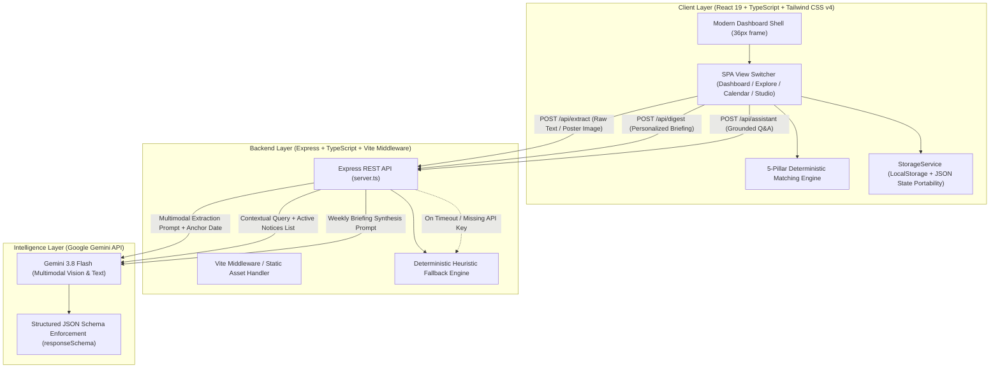

# Campus Radar (CampVibe)

> **Don't Miss What Matters.**  
> An intelligent, AI-powered campus opportunity discovery and notice intake platform built for collegiate ecosystems.

[](https://react.dev/)
[](https://www.typescriptlang.org/)
[](https://tailwindcss.com/)
[](https://expressjs.com/)
[](https://ai.google.dev/)
[](https://vitejs.dev/)
[](LICENSE)

---

## 📌 Table of Contents

- [The Problem](#-the-problem)
- [Our Solution](#-our-solution)
- [Key Features](#-key-features)
- [Technology Stack](#-technology-stack)
- [System Architecture](#-system-architecture)
- [Project Structure](#-project-structure)
- [Installation & Setup](#-installation--setup)
- [Automated Testing](#-automated-testing)
- [How to Use & Demonstration Workflows](#-how-to-use--demonstration-workflows)
- [Screenshots & Demo](#-screenshots--demo)
- [Security & Privacy](#-security--privacy)
- [Future Roadmap](#-future-roadmap)
- [Team & Credits](#-team--credits)
- [License](#-license)

---

## 🚨 The Problem

In modern universities and engineering institutes, vital academic and professional announcements are distributed through chaotic, disconnected channels:
- **Noisy WhatsApp Groups & Telegram Channels:** Essential notices get buried under hundreds of student reactions and casual chit-chat.
- **Unstructured Visual Flyers:** Event coordinators share Instagram stories and posters containing critical dates, eligibility criteria, and links in raster image format that cannot be searched, indexed, or filtered.
- **Ambiguous Timelines:** Notices frequently rely on relative phrases like *"tomorrow evening"*, *"next Friday"*, or *"registration closes tonight"* without providing concrete calendar timestamps or calendar invites.
- **Generic Broadcasts:** Every student receives identical mass broadcasts regardless of branch, academic year, or personal career aspirations. High-value hackathons, research grants, and placement mock drives are missed by the very students who need them most.
- **Schedule Clashes & Duplicates:** Multiple student clubs unknowingly schedule overlapping events in identical time slots and campus venues.

---

## 💡 Our Solution

**Campus Radar** transforms fragmented, unstructured campus communications into a verifiable, structured, and personalized opportunity pipeline. 

Designed specifically for collegiate environments (tailored for **Moradabad Institute of Technology / MiT**), Campus Radar provides:
1. **Multimodal Ingestion:** Students and faculty paste unstructured text forwards or drag-and-drop event flyers. Google's **Gemini 3.8 Flash** extracts titles, organizers, venues, deadlines, and registration URLs under strict JSON schema enforcement.
2. **Fact-Checked Evidence Verification:** Extracted fields must be substantiated by quoted verbatim substrings from the source document to prevent AI hallucination.
3. **Deterministic 5-Factor Personalization:** An algorithm ranks each notice (0–100 match score) against the student’s department, academic year, technical interests, and career goals.
4. **Notice Hygiene & Clash Engine:** Detects potential duplicate announcements via token-based Jaccard similarity and warns organizers about venue/time schedule conflicts.
5. **Grounded AI Campus Assistant:** A contextual Q&A chatbot that answers queries strictly grounded in currently active campus announcements.
6. **Zero-Dependency Offline Resilience:** If the external LLM API is unavailable, a deterministic local heuristic parser ensures the application remains fully functional.

---

## ✨ Key Features

### 1. 📥 AI Announcement Ingestion Studio
- **Multi-Source Support:** Ingest notices from WhatsApp blasts, emails, official circulars, notice boards, or event posters.
- **Multimodal Poster OCR:** Upload PNG, JPG, WebP, or SVG event flyers. The server-side Gemini 3.8 Flash vision pipeline processes the flyer and extracts all key details.
- **Temporal Resolution:** Translates relative phrases (e.g., *"this Thursday at 4 PM"*) into exact ISO timestamps (`2026-11-05 16:00`) anchored against a reference date context.
- **Dual-Pane Verification Studio:** Organizers inspect the extracted structured fields on the left alongside the verbatim source text and quotes on the right before publishing.

### 2. 🛡️ Notice Hygiene & Conflict Detection
- **Duplicate Prevention:** Calculates tokenized Jaccard similarity against existing announcements to detect reposts (>65% overlap or matching registration URLs).
- **Schedule Clash Detection:** Flags simultaneous bookings occurring on the same date and overlapping time windows.

### 3. 🎯 Personalized Recommendation Engine
Calculates a transparent, deterministic matching score (0–100) using a 5-pillar weighting model:
| Pillar | Weight | Description |
|---|---|---|
| **Technical Interests** | `40%` | Direct keyword and topical correlation with student interest tags |
| **Career Aspirations** | `20%` | Industry and career track alignment (e.g., AI Research, Core Placement, Startup) |
| **Department Relevance** | `15%` | Direct targeting vs. open-to-all vs. out-of-branch eligibility penalties |
| **Academic Year / Batch** | `15%` | Eligibility check (Freshman, Sophomore, Pre-Final, Final Year) |
| **Approaching Deadline Bonus** | `10%` | Temporal urgency booster for notices closing within 48–72 hours |

### 4. 📊 Modern Executive Dashboard
- **Dark Analytics Card:** Conic-gradient donut chart showing monthly event distribution, match distribution bar graph, and events-tracked milestones with a gold trophy status badge.
- **Recommended For You:** Ranked opportunity cards with custom SVG artwork, match badges, and immediate action triggers.
- **Critical Urgency Row:** Pulsing badges highlighting items requiring action within 48 hours.

### 5. 📅 Master Campus Schedule & Calendar
- **Interactive Multi-Views:** Switch smoothly between **Month**, **Week**, and **Day** calendar views.
- **Category Filter Bar:** Filter by Academic, Technical, Cultural, Sports, Competitions, Workshops, Internships, or Deadlines.
- **Direct Date Navigation:** Jump to today's schedule or inspect specific days with color-coded deadline badges.

### 6. 📂 Opportunity Pipeline & iCalendar Export
- **Kanban-Style Pipeline:** Organize notices into `Saved`, `Interested`, `Applied / Registered`, and `Completed` folders.
- **One-Click `.ics` Export:** Export single notices or entire opportunity folders directly to Apple Calendar, Google Calendar, or Microsoft Outlook.

### 7. 📰 AI Synthesized Weekly Intelligence Briefing
- **One-Sentence Headline & Executive Summary:** Generated on demand for the student's specific profile and branch.
- **Must-Do Action Items:** Highlighted priority items with explicit cutoff deadlines.
- **Day-by-Day Campus Schedule:** Chronological timeline of workshops, labs, and deadlines.
- **Clipboard Export:** Format and copy the briefing to clipboard with one click.

### 8. 💬 Grounded AI Campus Assistant
- Natural language chat assistant powered by Gemini 3.8 Flash.
- **Anti-Hallucination Constraints:** Answers queries solely based on active campus database records.
- **Interactive Cards:** Chat responses include clickable cards linking directly to the verified announcement modal.

---

## 🛠️ Technology Stack

| Domain | Technology / Library | Purpose |
|---|---|---|
| **Frontend Framework** | **React 19** (`react`, `react-dom`) | Component-driven UI architecture |
| **Language** | **TypeScript 5.8+** | Strict static typing across client and server |
| **Build & Dev Tool** | **Vite 8** (`@vitejs/plugin-react`) | Rapid HMR and optimized production bundling |
| **Styling & Design System** | **Tailwind CSS v4** (`@tailwindcss/vite`) | Utility-first CSS, custom CSS tokens, modern aesthetic |
| **Icons & Micro-Interactions** | **Lucide React** (`lucide-react`) & **Motion** (`motion`) | Consistent iconography and smooth layout animations |
| **Backend Server** | **Node.js** + **Express 4.21** (`express`) | API endpoints, Vite middleware bridge, static asset serving |
| **TypeScript Execution** | **TSX** (`tsx`) | Native TypeScript execution for the server runtime |
| **AI / Multimodal LLM** | **Google GenAI SDK** (`@google/genai` v2.4.0) | Gemini 3.8 Flash multimodal structured extraction & assistant |
| **State & Persistence** | **Browser LocalStorage** + In-Memory Fallback | Zero-setup persistent client storage with JSON import/export |

---

## 🏗️ System Architecture



### Request Lifecycle Overview:
1. **Notice Submission:** When text or an event flyer is submitted, the client sends a payload to `POST /api/extract` with the anchor calendar context (`today: 2026-10-31`, timezone: `Asia/Kolkata`).
2. **Gemini Multimodal Processing:** The server calls `gemini-3.8-flash` using `@google/genai` with strict `responseSchema` definitions. SVGs are forwarded as text XML, while raster images are sent as base64 inline data.
3. **Evidence Verification Pass:** The server iterates over extracted fields (dates, venues, deadlines) and verifies that quotes exist verbatim in the source text before returning the payload.
4. **Local Evaluation:** The client receives the structured payload, checks for duplicate/schedule collisions via `checkConflictsAndDuplicates()`, and computes personalized match percentages using `calculateRelevance()`.
5. **Offline Graceful Degradation:** If `GEMINI_API_KEY` is omitted or network latency exceeds the threshold, the server seamlessly falls back to the deterministic heuristic parser.

---

## 📁 Project Structure

```
CampVibe/
├── .env.example                 # Environment variable templates
├── index.html                   # Application entry HTML with Plus Jakarta Sans & JetBrains Mono
├── metadata.json                # Project capabilities metadata
├── package.json                 # Project dependencies and npm scripts
├── server.ts                    # Full-stack Express server + Gemini AI API integrations
├── tsconfig.json                # TypeScript compiler configuration
├── vite.config.ts               # Vite configuration with Tailwind CSS v4 plugin & aliases
├── public/                      # Static assets
└── src/
    ├── App.tsx                  # Root application component with layout shell & state management
    ├── index.css                # Global styles, Tailwind CSS v4 tokens, custom scrollbars, donut chart
    ├── main.tsx                 # React DOM mount point
    ├── components/              # Modular UI components
    │   ├── AiCampusAssistant.tsx      # Grounded AI chat modal with announcement citations
    │   ├── EditAnnouncementModal.tsx  # Modal for editing notice metadata and priorities
    │   ├── NoticeCard.tsx             # Interactive opportunity card with date tiles & bookmarking
    │   ├── NoticeDetailModal.tsx      # Comprehensive notice inspector with verbatim raw quotes
    │   ├── NotificationModal.tsx      # Notification centre with read/unread filters
    │   ├── OnboardingModal.tsx        # 2-step student profile onboarding with judge demo mode
    │   ├── ShareAnnouncementModal.tsx # Pre-formatted WhatsApp and native sharing modal
    │   ├── Sidebar.tsx                # Persistent sidebar with MiT branding & persona switcher
    │   └── TopNav.tsx                 # Search bar with recent history, greetings, and action buttons
    ├── lib/                     # Core business logic & algorithms
    │   ├── conflicts.ts         # Jaccard similarity duplicate & schedule clash detection
    │   ├── dates.ts             # Timezone-aware date calculations, status tags, & ICS generator
    │   ├── scoring.ts           # 5-factor personalized relevance scoring algorithm (0-100)
    │   ├── seedData.ts          # 12 realistic demonstration notices & 3 distinct student personas
    │   └── storage.ts           # LocalStorage wrapper, schema versioning, JSON backup/restore
    ├── pages/                   # Application page views
    │   ├── AddAnnouncement.tsx  # AI Notice Ingestion Studio (Text + Multimodal Poster OCR)
    │   ├── CalendarPage.tsx     # Master Campus Calendar (Month, Week, Day views)
    │   ├── ExplorePage.tsx      # Searchable & filterable directory of campus opportunities
    │   ├── HomeDashboard.tsx    # Executive dashboard with analytics card & recommendations
    │   ├── MyInterestsPage.tsx  # Academic identity settings & real-time matching preview
    │   ├── MyOpportunitiesPage.tsx # Opportunity pipeline Kanban (Saved, Interested, Applied, Done)
    │   ├── SettingsPage.tsx     # Demo persona switcher, seed data reset, and JSON export/import
    │   └── WeeklyBriefingPage.tsx # AI synthesized weekly intelligence briefing
    └── types/
        └── index.ts             # TypeScript interfaces (CampusAnnouncement, StudentProfile, etc.)
```

---

## 🚀 Installation & Setup

### Prerequisites
- **Node.js**: `v18.0.0` or higher (Node 20+ recommended)
- **npm**: `v9.0.0` or higher
- **Google Gemini API Key**: *(Optional)* Required for live Gemini 3.8 Flash model execution. If not provided, the app will run using its built-in heuristic fallback engine.

### Step 1: Clone Repository
```bash
git clone https://github.com/Yashgoswami2007/CampVibe.git
cd CampVibe
```

### Step 2: Install Dependencies
```bash
npm install
```

### Step 3: Configure Environment Variables
Copy the `.env.example` file to create your `.env` configuration:
```bash
cp .env.example .env
```
Open `.env` in your editor and configure the variables:
```env
# Required for live Gemini API calls. Get a free key at https://aistudio.google.com/
GEMINI_API_KEY="your-gemini-api-key-here"

# Port for the Express server (default: 3000)
PORT=3000

# Base URL for self-referential links (optional for local development)
APP_URL="http://localhost:3000"
```

### Step 4: Run the Development Server
```bash
npm run dev
```
The application will launch with Vite middleware enabled at:
```
http://localhost:3000
```

### Step 5: Build for Production
To test the production build:
```bash
npm run build
npm run start
```

---

## 📖 How to Use & Demonstration Workflows

### Workflow 1: Evaluating the Personalization Engine (Demo Mode)
1. Navigate to **Help & Settings** or use the profile selector at the bottom of the sidebar.
2. Switch between the 3 realistic pre-seeded personas:
   - **Yash Goswami** (3rd Year CSE — Focus: *AI/ML, Hackathons, Web Dev*)
   - **Ananya Sharma** (4th Year ECE — Focus: *Placements, Internships, Core Hardware*)
   - **Rohan Verma** (2nd Year Mech — Focus: *Sports, Cultural, Student Council*)
3. Observe how the **Home Dashboard**, **Explore**, and **Weekly Briefing** instantly recalculate match scores, urgency tiers, and top recommended cards based on the selected student's profile.

### Workflow 2: Ingesting an Unstructured Notice / Poster
1. Click **Smart Add** in the navigation sidebar or click the `+ Add Notice` button.
2. Select a source channel (e.g., *WhatsApp*, *Poster*, or *Circular*).
3. Test using one of two methods:
   - **Text Forward:** Click one of the quick-sample chips (e.g., *E-Cell Bootcamp* or *National AI Hackathon*).
   - **Multimodal Poster OCR:** Click **Try Sample Poster Flyer** or upload your own event graphic.
4. Click **Analyze Poster & Announcement**.
5. Inspect the extracted fields, temporal resolution phrases, and verified quotes in the dual-pane review studio.
6. Click **Confirm and Publish** to add the notice to the live campus registry.

### Workflow 3: Organizing Opportunities & Calendar Export
1. On any notice card, click the bookmark icon to save it.
2. Open **My Opportunities** in the sidebar to view your pipeline folders: `Saved`, `Interested`, `Applied / Registered`, and `Completed`.
3. Click **Export Folder (.ics)** to export your entire tracked pipeline as an iCalendar file, or click **Add to Calendar** inside any notice detail modal.

### Workflow 4: Consulting the AI Campus Assistant
1. Click **Ask AI** in the top navigation bar or press the assistant shortcut.
2. Ask natural campus questions such as:
   - *"What is happening today on campus?"*
   - *"What deadlines are closing in the next 48 hours?"*
   - *"Are there any paid internship or placement drives for 4th years?"*
3. The assistant will answer using only verified announcements and will present clickable cards to open the referenced notices.

---

## 📸 Screenshots & Demo

> *Note: Replace the placeholders below with actual project recordings and screenshots for hackathon submissions.*

| Screen | Preview Placeholder |
|---|---|
| **Executive Home Dashboard** | `[Insert Dashboard Screenshot Here: Dark Analytics Banner, Donut Chart, Recommended Cards]` |
| **AI Notice Ingestion Studio** | `[Insert Ingestion Studio Screenshot: Multimodal Poster Upload & Dual-Pane Verification]` |
| **Master Campus Calendar** | `[Insert Master Calendar Screenshot: Month/Week/Day Views with Deadline Markers]` |
| **Grounded AI Campus Assistant** | `[Insert AI Assistant Screenshot: Chat Interface with Referenced Opportunity Cards]` |

- **Live Demonstration Video:** `[Insert YouTube / Loom Video Link Here]`
- **Live Hosted Application:** `[Insert Live Deployment URL Here]`

---

## 🔒 Security & Privacy

- **Server-Side API Key Isolation:** The `GEMINI_API_KEY` is consumed exclusively on the backend (`server.ts`). It is never bundled into client-side code or exposed via browser network inspection.
- **Client-Side Data Sovereignty:** Student profiles, tracked pipeline states, and personal interests are stored in the user's browser `localStorage`. No personal student profile data is permanently stored on external database servers.
- **Anti-Hallucination Guardrails:** The AI Ingestion engine requires verified quotes from the original notice text. The AI Campus Assistant is constrained via system prompts to answer solely from active announcement records.
- **Controlled Ingestion Sanitization:** The server enforces payload size limits (`10MB`) on incoming requests to prevent denial-of-service via large image payloads.

---

## 🗺️ Future Roadmap

The current version of Campus Radar is a functional hackathon application. The following features represent realistic planned extensions:

- [ ] **WhatsApp Bot Webhook Integration:** Enable student club leads to forward messages directly to a verified WhatsApp Business webhook for automated background ingestion.
- [ ] **Institutional Single Sign-On (SSO):** Integration with Google Workspace for Education / Microsoft Entra ID to automatically populate student roll numbers, departments, and batches.
- [ ] **Role-Based Access Control (RBAC):** Faculty verification workflows for official circulars with cryptographic signing.
- [ ] **Push Notifications via Web Push API:** Browser-based service worker alerts for notices closing within 12 hours.
- [ ] **Vector Database Semantic Search:** Embedding notice records with Google Text Embedding models in Pinecone / ChromaDB for deeper semantic similarity search.

---

## 👥 Team & Credits

Developed with ❤️ for the Hackathon by:

| Contributor | Role & Contributions | Profile Links |
|---|---|---|
| **[Yash Goswami](https://github.com/Yashgoswami2007)** | *Full-Stack Architecture, AI Multimodal Pipeline, UI/UX Engineering* | [](https://github.com/Yashgoswami2007) |
| **[Team Member 2]** | *[Add Role: e.g., Backend Engineering, System Testing]* | `[Insert Link]` |
| **[Team Member 3]** | *[Add Role: e.g., UI Design, Research]* | `[Insert Link]` |

---

## 📄 License

This project is licensed under the **Apache License 2.0**. See the source file headers for licensing details.


---

## 🧪 Automated Testing

CampVibe uses Node's built-in test runner through the existing `tsx` TypeScript runtime. No separate test framework dependency is required.

Run the unit tests:

```bash
bun run test
```

Run the tests with Node's experimental coverage report:

```bash
bun run test:coverage
```

The suite currently exercises the date utilities, announcement status and priority calculations, iCalendar generation, duplicate detection, relevance scoring, local storage behavior, opportunity tracking, notifications, recent searches, and backup/restore workflows.

GitHub Actions runs the test and coverage command, TypeScript check, and production build for pushes and pull requests. A passing local suite is not a substitute for checking the CI result on the commit being submitted.
